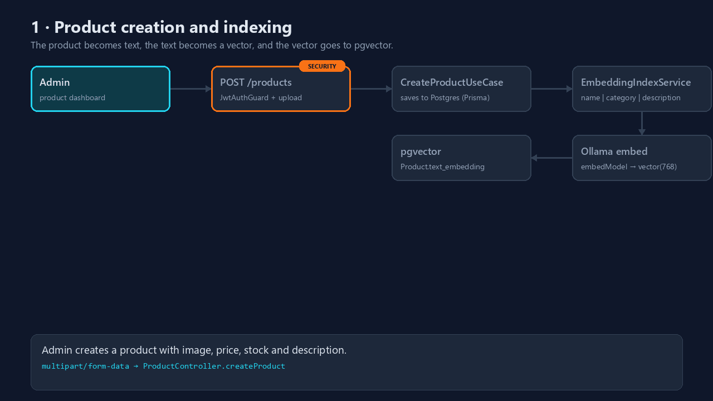

# APP

🇧🇷 [Leia em português](README.md)

I built this project to create an e-commerce platform where users can add products to the cart, remove them, adjust quantities and check out. After payment the stock is debited, and products that run out of stock are removed from the products page. The frontend was built with React, Zustand and React Query, each chosen for a specific reason. React allows reusable components, which makes maintenance easier and speeds up development. Zustand handles global state thanks to its simplicity and efficiency, keeping data such as the shopping cart and the user across pages. React Query handles API calls, caching and data refetching.

The backend was built with Node.js, PostgreSQL and TypeScript, using the Nest.js framework for the APIs. Node.js was chosen for building fast, scalable applications in JavaScript, while PostgreSQL provides relational consistency for product and user data. Prisma manages the database.

The main focus of this project was integrating Stripe as the payment method, improving my skills with payment APIs. Through this integration I deepened my knowledge of online payments, billing automation and secure handling of financial data.

### AI chat flow



### Cloning the repository

```sh
gh repo clone GuiOrlandin/e-commerce-with-stripe
```

### Go to the project folders

```sh
cd api
```

```sh
cd web
```

## Back-end (API)

### Install dependencies

```sh
npm i
```

### Start the database (PostgreSQL)

```sh
docker compose up -d
```

### Set the environment variables

Copy `.env.example` to `.env` and fill in `JWT_SECRET`, `JWT_EXPIRE` and `STRIPE_SECRET_KEY`.

### Run the Prisma migrations

```sh
npm run db:migrate
```

### Start the back-end

```sh
npm run start:dev
```

## Front-end (WEB)

### Install dependencies

```sh
npm i
```

### Start the front-end

```sh
npm run dev
```

### Run the front-end tests

```sh
npm run test
```

### AI chat (Ollama + embeddings)

1. Start Ollama (`ollama serve`) and pull `nomic-embed-text` (+ a chat model).
2. Reindex products: `cd api && npm run db:reindex-products`.
3. The UI uses `POST /chat/v2` (LangChain agent + `conversationId`). The old pipeline remains at `POST /chat`.
4. The chat requires **login** (JWT). There is a per-user throttle and a daily quota of estimated tokens (see `.env.example`).

### AI studies applied in this project

The chat was how I studied AI Engineering in practice. Every concept below is implemented in the code:

- **Embeddings + pgvector**: products become vectors (`nomic-embed-text` via Ollama) stored in PostgreSQL with pgvector.
- **Hybrid search + RRF**: keyword and semantic search combined with Reciprocal Rank Fusion (`rrfMerge.ts`).
- **Re-ranking**: a local model reorders the candidates before the answer (`rerankOrder.ts`).
- **RAG and grounding**: the agent answers only with catalog products, and the cited products are checked against the reply (`groundProductsInReply.ts`).
- **Agent with tools (LangChain)**: ReAct loop with a search tool, per-user/conversation memory, and limits on iterations and history.
- **Defensive prompt engineering**: shared system prompt and a delimited catalog against prompt injection (`prompts.ts`).
- **Output judge**: deterministic validation of prices and links before returning the reply (`judgeReply.ts`).
- **Cost and limits**: per-user throttle and a daily quota settled with real token usage.
- **Offline evaluation**: golden set with hit@k/recall@k metrics and red-team cases (`npm run eval`).
- **Observability**: one structured log line per chat request.
